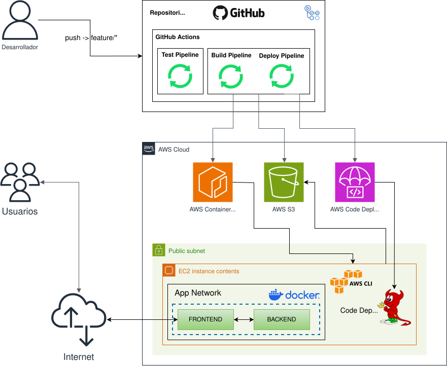

# Taller de DevOps con un Monorepositorio - AWS

Este repositorio tiene como propósito mostrar el despliegue de una aplicación *FullStack* en la nube de AWS mediante flujos de CI/CD con GitHub Actions, construyendo la imagen del *Backend* y *Frontend* en un repositorio de AWS Container Registry y el despliegue con Code Deploy y S3 en una instancia de EC2 utilizando el protocolo OIDC para la *Autenticación* y *Autorización* con AWS y GitHub.

## Arquitectura y flujo de construcción




### Happy Path


1. El desarrollador hace un push a una rama `feature/*`.
2. Se activa el workflow de GitHub Actions para ejecutar las pruebas unitarias, analisis de código, seguridad, etc.
3. Si el workflow anterior se ejecuta correctamente entonces el desarrollador puede hacer un pull request a main.
4. Alguien aprueba el pull request y los cambios se integran a main
5. Cuando los cambios se integran a main se ejecuta el workflow de build y deploy
6. El workflow construye la imágen y las sube a los repositorios de ECR
7. Se suben los archivos de configuración de Code Deploy a S3
8. Se lanza una implementación de Code Deploy en el servidor/instancia de EC2
9. El agente de Code Deploy baja los archivos de configuración de S3
10. El agente de Code Deploy ejecuta los scripts definidos en el archivo de configuración
11. Los scripts detienen la aplicación actual, baja la versión especificada de las imágenes de la aplicación guardadas en ECR y ejecutan la aplicación de la nueva versión con Docker

## Sobre el repositorio

### Estructura mínima del proyecto

```
mi-repo/
├── docker-compose.yml          ← versión para producción (usa imágenes de ECR)
├── docker-compose.override.yml ← versión local (builds locales, opcional)
├── appspec.yml                 ← leído por el agente de CodeDeploy
├── scripts/
│   ├── before_install.sh       ← limpieza previa
│   ├── after_install.sh        ← configura permisos
│   └── start_app.sh            ← docker compose pull + up
├── frontend/
│   ├── Dockerfile
│   └── ... tu código
├── backend/
│   ├── Dockerfile
│   └── ... tu código
└── .github/
    └── workflows/
        ├── tests.yml           ← Workflow 1: Tests unitarios
        └── deploy.yml          ← Workflow 2: Construcción y despliegue
```

#### El archivo `appspec.yml`

Este archivo le dice al agente de CodeDeploy qué hacer y dónde copiar los archivos:

```yaml
version: 0.0
os: linux
files:
  - source: /
    destination: /opt/mi-app

hooks:
  BeforeInstall:
    - location: scripts/before_install.sh
      timeout: 60
      runas: root
  AfterInstall:
    - location: scripts/after_install.sh
      timeout: 60
      runas: root
  ApplicationStart:
    - location: scripts/start_app.sh
      timeout: 300
      runas: root
```

#### Los scripts

**`scripts/before_install.sh`** — limpia la instalación anterior:

**`scripts/after_install.sh`** — establece permisos:

**`scripts/start_app.sh`** — el corazón del despliegue:

Asegúrate de que los scripts tienen permisos de ejecución antes de hacer commit:

```bash
chmod +x scripts/*.sh
```

### Los workflows de GitHub Actions

Ve a tu repo → **Settings → Secrets and variables → Actions Variables → New repository variable** y agrega estas variables (no secretos, son valores no sensibles):

| Nombre             | Valor de ejemplo                                         |
| ------------------ | -------------------------------------------------------- |
| `AWS_ACCOUNT_ID`   | `123456789012`                                           |
| `AWS_REGION`       | `us-east-1`                                              |
| `AWS_ROLE_ARN`     | `arn:aws:iam::123456789012:role/GitHubActionsDeployRole` |
| `ECR_REGISTRY`     | `123456789012.dkr.ecr.us-east-1.amazonaws.com`           |
| `S3_BUCKET`        | `mi-app-codedeploy-NOMBRE-UNICO`                         |
| `CODEDEPLOY_APP`   | `mi-app`                                                 |
| `CODEDEPLOY_GROUP` | `produccion`                                             |

#### Workflow 1 — Build y push a ECR (`.github/workflows/build.yml`)

Se activa en cada push a `main`. Construye todas las imágenes y las sube a ECR

#### Workflow 2 — Deploy al crear un tag (`.github/workflows/deploy.yml`)

Se activa cuando creas un tag con formato `v1.0.0`, `v2.3.1`, etc. Toma las imágenes ya construidas (usando el SHA del commit del tag) y las despliega:

## Guía de Configuración

### Requisitos previos

- Cuenta de AWS con acceso desde la AWS CLI con las siguiente políticas:
    - IAMFullAccess
    - AmazonEC2ContainerRegistryFullAccess
    - AmazonEC2FullAccess
    - AmazonS3FullAccess
    - AmazonVPCFullAccess
    - AWSCodeDeployFullAccess

- AWS CLI instalada en su computadora

- Archivo csv con su access key de su cuenta

### Guías

1. **Configuración de IAM**

    * [Guía para configurar IAM](./docs/iam.md#aws-identity-and-access-managemente-iam)

2. **Configuración de repositorios de imágenes Docker con ECR**

    * [Guía para configurar repositorios ECR](./docs/ecr.md)

3. **Configuración de un bucket S3**

    * [Guía para configurar el bucket de S3](./docs/s3.md)

4. **Configuración de una VPC**

    * [Guía para configurar la VPC](./docs/vpc.md)

5. **Configuración de una instancia de EC2**

    * [Guía para configurar la instancia de EC2](./docs/ec2.md)

6. **Configuración de una aplicación con Code Deploy**

    * [Guía para configurar una aplicación con Code Deploy](./docs/codedeploy.md)

7. **Eliminación de recursos**

    * [Guía para eliminar todos los recursos creados](./docs/cleanup.md)